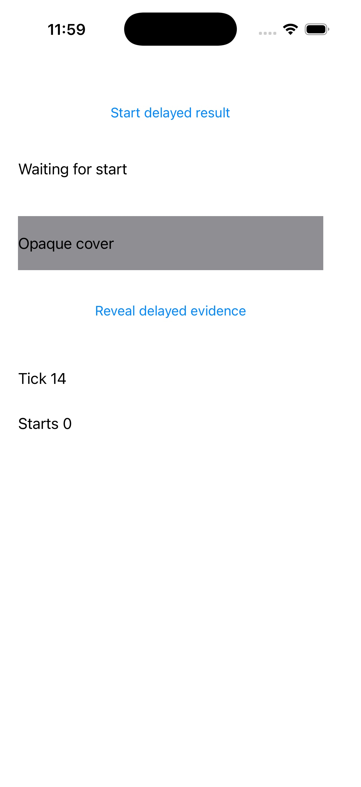
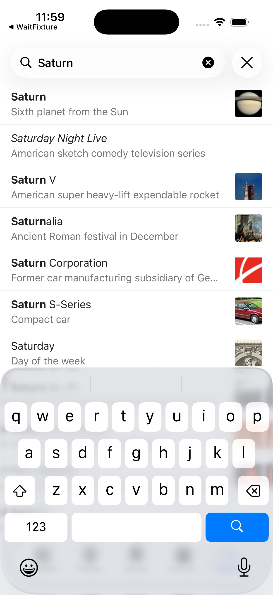

# UI wait validation, 2026-10-28

## Baseline

The baseline was `a220b19`. Validation used an Apple M2 Mac with 8 GiB RAM, Xcode 26.6, and the iOS 26.5 Simulator runtime. The explicit managed test phone was `E9008971-4EC6-4654-AA32-11E2AD84D7A0`, named `Wikipedia / Light`. All simulator changes used its lease. Other managed phones remained shut down.

The test app in `tests/fixtures/WaitFixture` has a delayed status label, a timer that changes every 100 ms, and a label covered by an opaque label at the same coordinates. Its explicit accessibility order includes the covered label before the cover. This is a test fixture. The demonstration app remains the official Wikipedia iOS app.

The baseline matrix assertion for `Covered evidence` passed while the screenshot showed only `Opaque cover`. A direct native `capture-targets` request at the shared center also returned the covered label's identity. The screenshot was inspected independently of the accessibility responses.

That counterexample rules out interpreting either accessibility-tree presence or a native accessibility center hit as proof of visual visibility. The wait contract must state its evidence source. A screenshot is a separate observation and does not become an automatic occlusion predicate.

## Verification

The integrated code at `ec617bf` passed `make test`, including the Go race detector and all nine Python tests. Behavioral regressions cover queued deadlines, late results, pipe/socket cancellation, callback joining, receipt validation, passive evidence, same-sample conditions, screenshot failures, typed startup readiness, CLI/MCP schemas and errors, and matrix steps. `make app` built the CLI, guest input helper, host vision helper, and dashboard.

The live run used:

```sh
python3 scripts/verify-ui-waits.py \
  --device E9008971-4EC6-4654-AA32-11E2AD84D7A0 \
  --shutdown --output .cache/ui-waits-final-live.json
```

It passed from 18:58:41 to 18:59:22 UTC. The matrix built and launched the fixture, checked legacy tree presence, pressed the delayed-result button once, and passed an explicit wait step. The subsequent CLI checks showed:

| Check | Actual result |
| --- | --- |
| Ready plus `Starts 1` in the same sample | Matched after 12 attempts and 2969 ms while an unrelated timer changed. |
| Ready with a 100 ms budget | Failed with `wait_timeout`; response diagnostics reported 102 ms. |
| Missing label with a 2000 ms budget | Failed after 8 attempts and 2002 ms; retained a non-actionable last observation. |
| Covered passive label | Both tree and native-hit matched; input was rejected. |
| Invalid visibility/empty/range/selector requests | Rejected. |
| MCP | 17 tools; match with image, failed timeout, and request cancellation all passed. |
| Wikipedia | Query value and Saturn result matched in one sample with a separately timestamped screenshot. |

The small elapsed-time overrun on timeouts is cleanup/response overhead. Results after the acceptance deadline are rejected; this API is not a hard real-time response guarantee.

The parent inspected the two screenshots below. In the first, only `Opaque cover` is drawn at the label's position, even though the same wait returned a native hit for `Covered evidence`. In the second, Wikipedia shows the Saturn query and result. These are independent visual inspections, not an automated visibility predicate.





The selected phone was shut down and its lease released. The other three managed phones remained shut down. Local full evidence is in `.cache/ui-waits-final-live.json`; its matrix report is `~/Library/Application Support/AgentPhone/runs/b6ef60b2008e3e145a3be5923da52658.json`. Build output is in `.cache/ui-waits-build.log`. These machine-specific artifacts remain ignored.

## Limits

This run exercised one managed phone on one Xcode/runtime combination. Four-phone regression checks were not repeated for this feature. Accessibility identity and screenshot timestamps remain separate, and native-hit evidence cannot prove occlusion or pixel visibility. Repeated reader unavailability times out; malformed or other helper failures remain terminal. The transport cancellation edge cases were exercised with deterministic pipes and sockets, while MCP cancellation was also verified live.

## Failures found during implementation

The first candidate's live matrix failed immediately after app launch with `kAXErrorServerNotFound`. Two subsequent diagnostic waits reported `window-server frontmost returned no application object`. A live screenshot showed the fixture running, and a later observation returned its complete tree. The one-shot startup design was therefore insufficient. The integration adds bounded retries for these two explicit reader readiness responses while keeping arbitrary transport and malformed protocol errors terminal.

Independent code review also identified two diagnostic gaps in the selected candidate. A screenshot failure lost the otherwise completed AX/native sample, and non-object native target receipts were silently treated as misses. Both are covered by integration regression tests before final live verification.

The final review found a separate MCP shutdown regression: the new signal handler canceled work but left an idle input read blocked after SIGTERM. Commit `80a8638` restores normal OS signal termination. Its subprocess test failed before the fix and passed afterward, including cancellation of an in-flight request to a fake Unix service. Notification cancellation and EOF cleanup are unchanged. `make test` and `make app` passed again after this fix. The rebuilt CLI also exited with SIGTERM in both idle and blocked-output checks with open stdio. The full simulator run above preceded this process-only correction; simulator wait code was unchanged.
